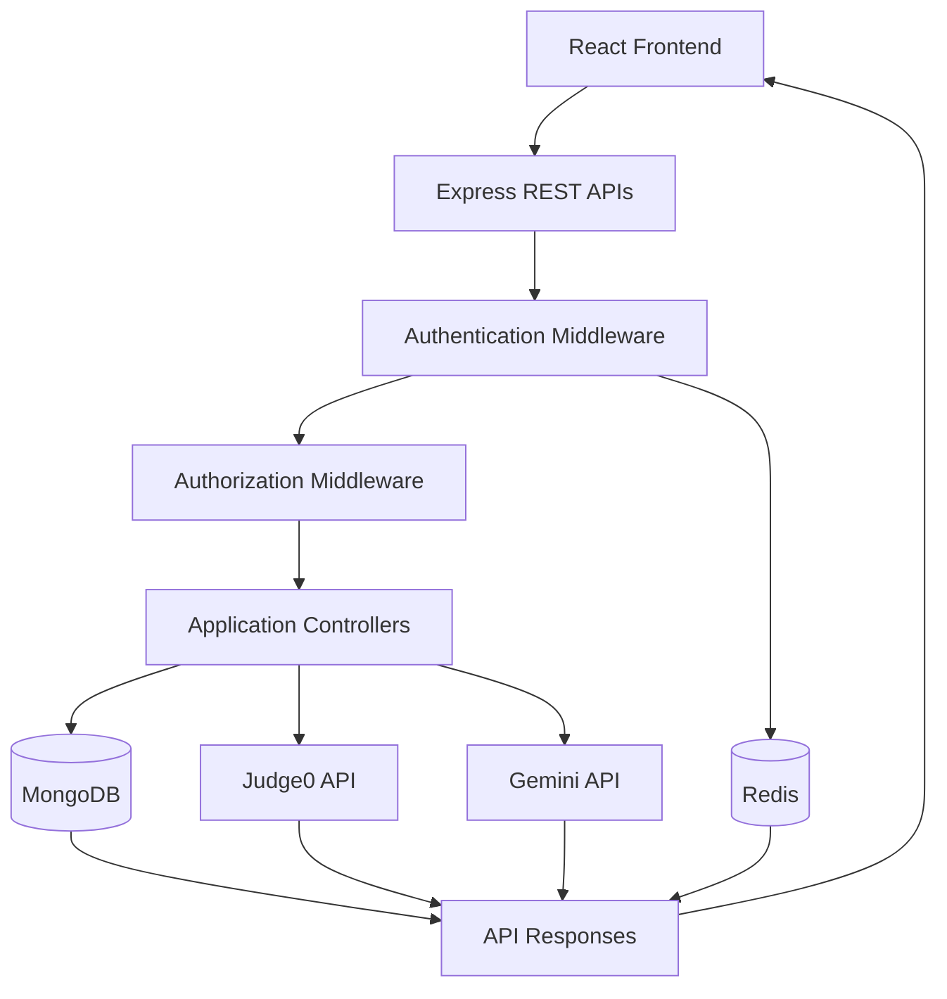

# 🚀 CodeWithMonk — Backend

**A Scalable Backend for an Interactive DSA Coding Platform**

CodeWithMonk is a full-stack coding platform designed to help developers practice Data Structures and Algorithms (DSA), execute and submit solutions, receive AI-powered assistance, and connect with fellow programmers.

This repository contains the backend built with **Node.js, Express.js, MongoDB, and Redis**. It provides REST APIs for authentication, authorization, coding problem management, code execution, submission evaluation, AI-assisted learning, and developer connections.

> 🛠️ **Project Focus:** Secure API development, authentication and authorization, external service integration, database management, and backend-driven application workflows.

---

## ✨ Key Features

### 🔐 1. Authentication & Session Security

- 📝 User registration and login APIs.
- 🔑 Password hashing using `bcrypt`.
- 🎟️ JWT-based authentication.
- 🍪 Cookie-based token handling.
- 🚪 Logout API with Redis-based token blacklisting.
- 🛡️ Authentication middleware for protected routes.
- 🔄 Token validation on authenticated requests.

**How logout works:** When a user logs out, the backend blacklists the relevant token using Redis. Subsequent authenticated requests can validate the token against the blacklist and reject revoked sessions.

### 🛡️ 2. Authorization & Access Control

- 👤 Authenticated-user access control.
- 🔑 Role-based authorization for administrative operations.
- 🛠️ Protected admin routes for managing coding problems.
- 🚫 Server-side permission checks to prevent unauthorized operations.

Authorization is enforced on the backend rather than relying on frontend navigation or visibility checks.

### 📚 3. DSA Problem Management

The backend provides APIs to manage coding problems and their associated evaluation data.

- ➕ Create new coding problems.
- 📖 Fetch individual problems and problem lists.
- ✏️ Update existing problem details.
- 🗑️ Delete coding problems.
- 🧪 Manage visible and hidden test cases.
- 💻 Store initial code and reference solutions for supported languages.
- 🏷️ Organize problems using difficulty levels and tags.
- 👨‍💻 Associate problems with their creators.

Administrative problem-management endpoints are protected by authentication and authorization middleware.

### ⚡ 4. Code Execution with Judge0

- ▶️ Execute submitted source code through Judge0.
- 🚀 Submit solutions for evaluation.
- 🧪 Evaluate code against configured test cases.
- 📊 Process execution status and evaluation results.
- 📜 Store and retrieve user submission history.
- 🧩 Support programming languages configured by the backend and Judge0 integration.

The backend coordinates code execution and evaluation, then returns the relevant results to the frontend.

> 💡 Supported languages, execution limits, and evaluation behavior depend on the configured Judge0 service and backend implementation.

### 🤖 5. AI-Powered DSA Chatbot

- 💬 Provide a backend API for AI-assisted coding conversations.
- 🧠 Generate DSA-focused hints and conceptual explanations.
- 📚 Help users understand coding problems and solution approaches.
- ⏱️ Discuss time and space complexity.
- 🔗 Integrate with Google's Gemini API through `@google/genai`.
- 🔒 Keep AI provider credentials on the server.

The backend connects the frontend's AI tutor to Gemini, allowing users to receive problem-related guidance without exposing the provider's secret key in the browser.

> ⚠️ AI-generated responses can be incorrect. Suggestions should be verified against the problem requirements and test cases.

### 🤝 6. Developer Connections & Social APIs

The backend supports a connection request workflow between platform users.

- 👥 Discover other developers through the feed API.
- 📈 Retrieve user information and problem-solving statistics for feed cards.
- 📤 Send connection requests.
- 📥 Retrieve incoming pending requests.
- ✅ Accept connection requests.
- ❌ Reject connection requests.
- 🔗 Retrieve accepted connections.
- 🚫 Ignore or exclude profiles according to the implemented feed rules.
- 🔄 Maintain request states and relationships between users.

The feed filtering logic excludes the authenticated user and users already associated with connection requests in either direction, according to the backend's rules.

### 📊 7. Submission & User Progress APIs

- 📤 Process code submissions.
- 📋 Retrieve submission history for a specific problem.
- 📈 Retrieve problem-solving information for users.
- 🧪 Track evaluation outcomes returned by the code execution integration.
- 🔗 Provide data required by the frontend's problem and profile interfaces.

The frontend uses these APIs to display execution feedback, submission results, history, and problem-solving statistics.

---

## 🧰 Tech Stack

| Category | Technology | Purpose |
|---|---|---|
| 🟢 Runtime | Node.js | JavaScript server runtime |
| 🚀 Framework | Express.js 5 | REST API development |
| 🍃 Database | MongoDB | Persistent application data |
| 🧩 ODM | Mongoose | MongoDB schemas and data operations |
| ⚡ Caching / Token Revocation | Redis | Token blacklisting and related operations |
| 🔐 Authentication | JSON Web Token (`jsonwebtoken`) | Token generation and verification |
| 🔒 Password Security | `bcrypt` | Password hashing |
| 🍪 Cookie Handling | `cookie-parser` | Parse incoming cookies |
| 🌐 Cross-Origin Requests | `cors` | Configure cross-origin API access |
| 🤖 AI Integration | Google Gemini, `@google/genai` | AI-powered DSA assistance |
| ⚖️ Code Execution | Judge0 API | Source code execution and evaluation |
| 🌍 HTTP Client | Axios | External API requests |
| 🧪 Input Validation | Validator.js | Input validation utilities |
| ⚙️ Configuration | dotenv | Environment variable loading |
| 🔄 Development | Nodemon | Automatic server restarts |

---

## 🏗️ Architecture Overview

CodeWithMonk follows a backend-driven architecture in which the frontend communicates with Express APIs, and the backend coordinates authentication, persistence, code evaluation, and AI services.



### 🔄 Request Lifecycle

1. The frontend sends an HTTP request through its shared Axios client.
2. Express routes direct the request to the appropriate middleware and handler.
3. Authentication middleware validates access to protected resources.
4. Authorization middleware checks the required permissions for restricted operations.
5. Controllers interact with MongoDB, Redis, or external APIs as needed.
6. The backend returns the response, which the frontend uses to update the interface.

---

## 📂 API Modules

The backend API surface is organized around the following functional areas:

| Module | Responsibilities |
|---|---|
| 🔐 User | Registration, login, logout, and authenticated user access |
| 🛡️ Authorization | Authentication middleware and admin access checks |
| 📚 Problem | Problem retrieval and problem-related operations |
| 🛠️ Admin | Problem creation, updates, and deletion |
| ⚡ Submission | Code execution, submission evaluation, and submission history |
| 🤖 AI Chatbot | Gemini-powered DSA assistance |
| 🤝 Connection | Feed, connection requests, and accepted connections |
| 📊 User Progress | Problem-solving statistics and solved-problem information |

> 📝 Exact endpoint paths, HTTP methods, and request payloads should be documented from the current Express route definitions to ensure the API reference matches the implementation.

---

## ⚙️ Getting Started

Follow these steps to run the backend locally.

### 📋 Prerequisites

Install or configure the following:

- [Node.js](https://nodejs.org/)
- npm
- [MongoDB](https://www.mongodb.com/)
- [Redis](https://redis.io/)
- A [Judge0](https://judge0.com/) instance or compatible API endpoint
- A Google Gemini API key for AI chatbot functionality

### 1️⃣ Clone the Repository

```bash
git clone https://github.com/Manish-dev3490/code-with-monk-backend.git
cd code-with-monk-backend
```

### 2️⃣ Install Dependencies

```bash
npm install
```

### 3️⃣ Configure Environment Variables

Create a `.env` file in the backend root directory.

Example configuration:

```env
PORT=3000

MONGODB_URI=your_mongodb_connection_string

REDIS_URL=your_redis_connection_url

JWT_SECRET=your_jwt_secret

GEMINI_API_KEY=your_gemini_api_key

JUDGE0_API_URL=your_judge0_api_url
JUDGE0_API_KEY=your_judge0_api_key
```

> ⚠️ These names are illustrative. Use the exact environment variable names referenced by your backend source code. Judge0 credentials may be unnecessary for a self-hosted instance, depending on its configuration.

**Security best practices:**

- Never commit `.env` files or API secrets to Git.
- Add `.env` to `.gitignore`.
- Use strong, private JWT signing secrets.
- Restrict database and Redis access.
- Keep Gemini and Judge0 credentials exclusively on the backend.
- Configure production CORS and cookie settings for the deployed frontend origin.

### 4️⃣ Start the Backend

The supplied `package.json` currently defines only a placeholder test script and does not declare a development or start script.

If the entry point is `index.js`, you can run:

```bash
node index.js
```

For development with Nodemon:

```bash
npx nodemon index.js
```

If the actual entry point is different, replace `index.js` with the correct file.

**Recommended `package.json` scripts:**

```json
"scripts": {
  "start": "node index.js",
  "dev": "nodemon index.js"
}
```

After adding these scripts, start the server with:

```bash
npm run dev
```

---

## 🔒 Security Considerations

Security is an important part of the backend architecture.

- 🔐 Passwords are hashed rather than stored as plaintext.
- 🎟️ JWT authentication protects authenticated routes.
- ⚡ Redis supports token revocation through blacklisting.
- 🛡️ Admin operations require backend-side authorization.
- 🍪 Cookie and CORS configuration must match the deployment environment.
- 🔑 External service credentials remain on the server.
- 🧪 Input validation helps protect API workflows from invalid data.

Production deployments should also validate authorization boundaries, handle errors consistently, restrict sensitive infrastructure access, and verify the security configuration of all external integrations.

---

## 🧪 Testing & Validation

Before deployment, validate the following workflows:

- [ ] Register a new account and log in.
- [ ] Verify password handling and authentication failures.
- [ ] Verify access to protected endpoints.
- [ ] Log out and confirm that the revoked token is rejected.
- [ ] Verify that normal users cannot access admin operations.
- [ ] Create, retrieve, update, and delete coding problems.
- [ ] Execute code using Judge0.
- [ ] Submit solutions and verify evaluation results.
- [ ] Retrieve submission history and problem-solving data.
- [ ] Test Gemini API success and failure responses.
- [ ] Send, accept, and reject connection requests.
- [ ] Verify feed filtering and accepted connections.
- [ ] Test missing inputs, invalid IDs, and external service failures.
- [ ] Verify database, Redis, and production environment configuration.

---

## 🚀 Future Improvements

Potential improvements for a production-ready platform include:

- 🧪 Automated unit and integration tests.
- 📝 API documentation using Swagger / OpenAPI.
- 🛡️ Rate limiting and additional abuse prevention.
- 📊 Structured logging and monitoring.
- 🐳 Docker-based deployment and environment consistency.
- 🔄 CI/CD automation.
- ⚡ Improved error handling and external API resilience.

These are potential enhancements and should not be considered implemented unless verified in the repository.

---

## 👨‍💻 Author

**Manish Kumar**

- 🐙 GitHub: [Manish-dev3490](https://github.com/Manish-dev3490)

---

⭐ **If you find CodeWithMonk interesting, consider starring the repository!**

*Built with Node.js, Express, MongoDB, Redis, and AI-powered integrations to make DSA practice more interactive.* 🚀